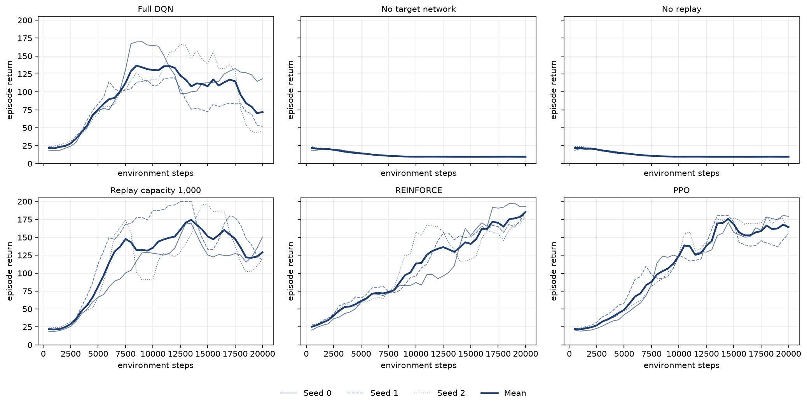
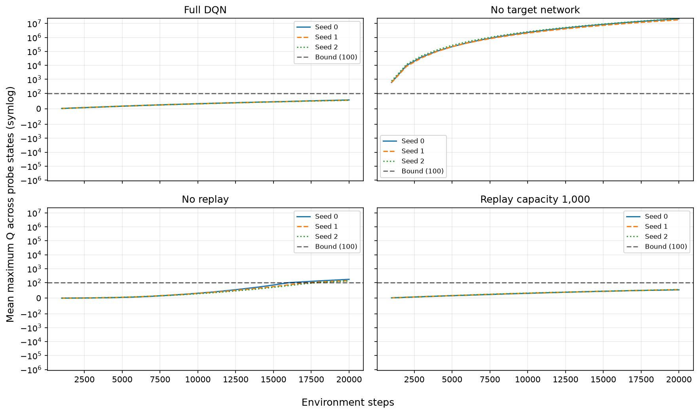

# AIGC-5500 Lab 9 - Training an RL Agent

**Student:** Daniel Alejandro Castillo Martin  
**Student ID:** N10019284  
**Course:** Advanced Deep Learning (AIGC-5500-0NA)  
**Professor:** Hossein Pourmodheji

---

Lab 09 submission for **Advanced Deep Learning (AIGC-5500)** in the Artificial Intelligence with Machine Learning postgraduate program at Humber Polytechnic.

This lab compares six reinforcement learning configurations on CartPole. The task is to balance a pole by moving the cart left or right. The environment has four state variables, gives one point per step, and caps episodes at 200 steps. Each configuration runs for 20,000 environment steps with seeds 0, 1, and 2.

## Setup

From the repository root, create a Python 3.14 environment. On Windows PowerShell:

```powershell
py -3.14 -m venv .venv
.\.venv\Scripts\Activate.ps1
python -m pip install -r requirements.txt --extra-index-url https://download.pytorch.org/whl/cpu
```

On macOS or Linux, use `python3.14 -m venv .venv` and `source .venv/bin/activate`, then run the same install command. The extra index provides the CPU build of PyTorch used in the lab.

## Run

Run the unmodified starter to verify the environment:

```bash
python scripts/lab09_starter.py
```

Open [the lab notebook](daniel_alejandro_castillo_martin_LAB9.ipynb) in VS Code or another notebook editor, select the `.venv` Python kernel, and restart the kernel and run all cells from the repository root. The notebook prints the checks and tables and regenerates the figures in `output/`.

| Lab piece | Notebook section | Experiment |
| --- | --- | --- |
| 1 | 2. Losses | Verify the Bellman targets, Huber loss, one-state fixed point, PPO clipping, and return-to-go. |
| 2 | 3. DQN Baseline | Train full DQN with uniform replay and a separate target network. |
| 3 | 4. DQN Ablations | Remove the target network, replace replay with single-use chronological batches, and reduce replay capacity to 1,000. |
| 4 | 5. Policy-Gradient Agents | Train REINFORCE with a learned value baseline and PPO with generalized advantage estimation. |
| 5 | 6. Final Comparison | Plot all six configurations and apply the decision rule to all 15 pairs. |

Agent implementations are in [src/dqn.py](src/dqn.py) and [src/policy_gradient.py](src/policy_gradient.py). The [starter](scripts/lab09_starter.py) provides the environment, networks, and reporting helpers.

## Hardware

The reported runs used Windows, Python 3.14.6, and PyTorch 2.15.0+cpu. The processor model was not recorded in the notebook. The 18 training runs took **490.8 seconds (8.18 minutes)** in total. This measures training time. Setup, checks, and figure generation add to the full notebook runtime.

## Prediction

The original pre-run estimates are missing from the available records. The following rationale is retrospective.

- **No target network.** The online network changes both the predicted value and the bootstrap target. Errors can feed back into later updates, which can inflate Q estimates above 100 and lower returns.
- **No replay.** Single-use chronological batches contain correlated transitions and produce fewer optimizer updates. This can hurt learning and make Q estimates less stable.
- **Replay capacity of 1,000.** A shorter history retains uniform sampling and transition reuse while giving more weight to recent experience.

## Decision Rule

A final-return difference is clear in these runs only when the observed minimum-to-maximum ranges across the three seeds do not overlap. Overlapping ranges leave the comparison unresolved. Steps to 150 and wall-clock time are reported separately. The notebook states and applies this rule. A separate record of when it was chosen is unavailable.

## Results

### Loss and fixed-point checks

```text
True termination (terminated = True, truncated = False) | target = 1.00 | expected = 1.00 | PASS
Ordinary transition (terminated = False, truncated = False) | target = 7.30 | expected = 7.30 | PASS
Time-limit truncation (terminated = False, truncated = True) | target = 7.30 | expected = 7.30 | PASS
Target requires gradients: False | PASS
Error +0.5 | Huber = 0.125 | expected = 0.125 | PyTorch = 0.125 | PASS
Error +3.0 | Huber = 2.500 | expected = 2.500 | PyTorch = 2.500 | PASS
Error -3.0 | Huber = 2.500 | expected = 2.500 | PyTorch = 2.500 | PASS
With target network | learned Q = 9.980935 | exact Q = 10.00 | absolute error = 0.019065
Without target network | learned Q = 9.999994 | exact Q = 10.00 | absolute error = 0.000006
Ratio = 1.3 | advantage = +1.0 | objective = +1.20 | expected = +1.20 | PASS
Ratio = 1.3 | advantage = -1.0 | objective = -1.30 | expected = -1.30 | PASS
Ratio = 0.7 | advantage = +1.0 | objective = +0.70 | expected = +0.70 | PASS
Ratio = 0.7 | advantage = -1.0 | objective = -0.80 | expected = -0.80 | PASS
Returns = [1.75, 1.5, 1.0] | expected = [1.75, 1.5, 1.0] | PASS
```

Ordinary transitions and time-limit truncations bootstrap from the next state. True terminations have zero future value. Masking time-limit truncations would teach DQN that the next state after reaching the episode cap has no value. In the one-state check, both estimates approached 10 after 3,000 Adam updates. The online-only target finished closer in this check, while the CartPole run without a separate target network produced very large Q estimates.

### Learning curves and per-seed results

Final return averages completed episodes ending in the last 2,000 environment steps. Steps to 150 is the first 500-step checkpoint where that trailing mean reached 150. Returns come from training episodes, including exploration, so they reflect each agent's behavior during training.



| Configuration | Seed | Final return | Steps to 150 | Training time (s) |
| --- | ---: | ---: | ---: | ---: |
| Full DQN | 0 | 118.35 | 8,000 | 52.8 |
| Full DQN | 1 | 52.15 | Never reached | 46.1 |
| Full DQN | 2 | 45.32 | 11,500 | 47.4 |
| No target network | 0 | 9.61 | Never reached | 51.9 |
| No target network | 1 | 9.53 | Never reached | 47.4 |
| No target network | 2 | 9.61 | Never reached | 45.6 |
| No replay | 0 | 9.61 | Never reached | 2.4 |
| No replay | 1 | 9.53 | Never reached | 3.3 |
| No replay | 2 | 9.57 | Never reached | 2.7 |
| Replay capacity 1,000 | 0 | 150.54 | 12,500 | 48.1 |
| Replay capacity 1,000 | 1 | 117.88 | 7,000 | 47.0 |
| Replay capacity 1,000 | 2 | 119.41 | 6,500 | 48.1 |
| REINFORCE | 0 | 192.90 | 14,500 | 6.1 |
| REINFORCE | 1 | 184.50 | 12,500 | 5.3 |
| REINFORCE | 2 | 178.91 | 10,000 | 5.4 |
| PPO | 0 | 179.27 | 13,500 | 10.4 |
| PPO | 1 | 155.23 | 13,000 | 10.7 |
| PPO | 2 | 158.25 | 10,500 | 10.0 |

Full DQN used epsilon-greedy exploration from 1.0 to 0.05 over the first 8,000 steps, with a 20,000-transition replay buffer and uniform batches of 64. Updates began after 500 steps, with Adam at 0.001, a discount of 0.99, Huber loss, and gradient clipping at 10. The target network was copied every 250 environment steps. See the [standalone DQN curves](output/dqn_baseline_curves.png).

REINFORCE updated after every eight complete episodes using a discount of 0.99, with Adam learning rates of 0.003 for the policy and 0.01 for the value baseline. Advantages were scaled by their batch standard deviation. PPO used 1,024-step rollouts with a shortened final rollout, six epochs of minibatches of up to 128, a clip of 0.2, GAE with a discount of 0.99 and lambda of 0.95, rollout-normalized advantages, Adam at 0.0003, a value loss weight of 0.5, and gradient clipping at 0.5.

### DQN ablations and Q-values

Every 1,000 environment steps, the online network was evaluated on the same 500 probe states. The figure plots the mean of the largest action value per probe state. The table reports the largest absolute action value observed across all probe checkpoints for each ablation. With a reward of 1 per step and a discount of 0.99, the discounted return is bounded above by 100.



| Configuration | Peak absolute Q, seed 0 | Peak absolute Q, seed 1 | Peak absolute Q, seed 2 |
| --- | ---: | ---: | ---: |
| No target network | 82,017,736.00 | 73,508,128.00 | 86,605,336.00 |
| No replay | 534.93 | 465.40 | 399.63 |
| Replay capacity 1,000 | 56.99 | 56.89 | 56.42 |

Removing the target network dropped the mean final return from 71.94 to 9.58, and peak absolute Q exceeded 73 million in every seed. Removing replay produced a similar mean final return of 9.57, with peak absolute Q between 399.63 and 534.93. Both ablations missed 150 on all three seeds.

The Module 09 example reports a 64-transition sliding window that did not hurt CartPole performance. Its window shifts by one transition per update, so transitions are reused. In this lab the no-replay agent used disjoint chronological batches, yielding 312 updates versus 19,500 with replay. The experiment combines correlated data, lack of reuse, and fewer updates. The 1,000-transition buffer retains both uniform sampling and reuse, so its comparison with full DQN tests replay capacity. Its mean final return was 129.28 and all seeds reached 150, but the final-return ranges overlap. An experiment with matched update counts and separate controls for sampling and reuse would be needed to attribute the no-replay drop to one of those factors.

### Final-return comparisons

| Configuration A | Range A | Configuration B | Range B | Decision |
| --- | ---: | --- | ---: | --- |
| Full DQN | 45.32–118.35 | No target network | 9.53–9.61 | Clear: Full DQN higher |
| Full DQN | 45.32–118.35 | No replay | 9.53–9.61 | Clear: Full DQN higher |
| Full DQN | 45.32–118.35 | Replay capacity 1,000 | 117.88–150.54 | Ranges overlap |
| Full DQN | 45.32–118.35 | REINFORCE | 178.91–192.90 | Clear: REINFORCE higher |
| Full DQN | 45.32–118.35 | PPO | 155.23–179.27 | Clear: PPO higher |
| No target network | 9.53–9.61 | No replay | 9.53–9.61 | Ranges overlap |
| No target network | 9.53–9.61 | Replay capacity 1,000 | 117.88–150.54 | Clear: Replay capacity 1,000 higher |
| No target network | 9.53–9.61 | REINFORCE | 178.91–192.90 | Clear: REINFORCE higher |
| No target network | 9.53–9.61 | PPO | 155.23–179.27 | Clear: PPO higher |
| No replay | 9.53–9.61 | Replay capacity 1,000 | 117.88–150.54 | Clear: Replay capacity 1,000 higher |
| No replay | 9.53–9.61 | REINFORCE | 178.91–192.90 | Clear: REINFORCE higher |
| No replay | 9.53–9.61 | PPO | 155.23–179.27 | Clear: PPO higher |
| Replay capacity 1,000 | 117.88–150.54 | REINFORCE | 178.91–192.90 | Clear: REINFORCE higher |
| Replay capacity 1,000 | 117.88–150.54 | PPO | 155.23–179.27 | Clear: PPO higher |
| REINFORCE | 178.91–192.90 | PPO | 155.23–179.27 | Ranges overlap |

## Conclusion

I would choose REINFORCE for high final return within this CartPole budget. It had the highest mean final return (185.44), reached 150 in all three seeds, and trained in 5.3–6.1 seconds per seed. Its final-return range overlaps PPO's, and PPO reached 150 earlier on seed 0 (13,500 versus 14,500 steps).

I would choose DQN with the 1,000-transition buffer to reach 150 early. It reached the threshold in all three seeds and crossed as early as 6,500 steps. Full DQN crossed sooner on seed 0 (8,000 versus 12,500 steps), and both policy-gradient agents had clearly higher final returns under the decision rule.

## Known Limitations

The tables and figures report the second Windows CPU run. After a kernel restart and full rerun on Windows, the loss checks, final returns, steps to 150, Q-value peaks, pairwise decisions, and all three figures matched the first run. The timing table reports the second run. A fresh Linux CPU run with Python 3.14.10 and PyTorch 2.15.0+cpu produced different full DQN results with the same seeds. For example, seed 0 finished at 42.80 and first reached 150 at step 9,000 on Linux. The reported Windows values were 118.35 and 8,000. The replay-capacity comparison also changed under the decision rule. Its final-return range overlapped full DQN on Windows and was higher with no overlap on Linux. All notebook code cells ran and regenerated the three figures in the Linux environment.

These results cover one four-variable task, small networks, a fixed budget of 20,000 environment steps, three seeds, and one hyperparameter setting per configuration. They describe the observed runs. Ranking these methods across tasks or drawing stronger conclusions about overlapping ranges would require more seeds and additional tasks or settings.
